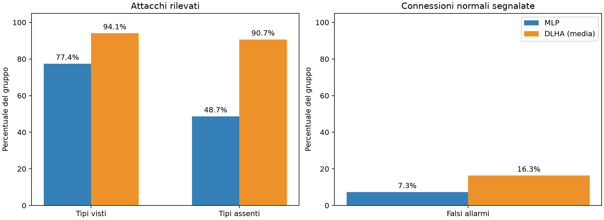

# NSL-KDD Intrusion Detection Benchmark

Progetto di tesi e portfolio sulla classificazione del traffico di rete in cinque famiglie: Normal, DoS, Probe, R2L e U2R. Il benchmark su NSL-KDD è completo. Include sei modelli, il confronto con Divekar et al. (2018), una diagnosi delle classi rare e un ultimo esperimento sul rilevamento di tipi di attacco assenti dal training.

## Risultati sul test ufficiale

I primi esperimenti usano split 80/20 all’interno di `KDDTrain+`. Per il confronto finale, i sei modelli sono riaddestrati sul **100% di `KDDTrain+`** (125.973 righe) e valutati su `KDDTest+` (22.544 righe). Il preprocessing è stimato sui dati di training.

| Modello | Macro F1 | Recall R2L | Recall U2R |
|---|---:|---:|---:|
| MLP | 0,5469 | 10,71% | 8,50% |
| Random Forest | 0,5270 | 10,24% | 5,00% |
| Decision Tree | 0,5099 | 5,45% | 3,50% |
| SVM RBF | 0,5063 | 8,71% | 1,50% |
| K-Means | 0,4846 | 1,63% | 6,00% |
| Gaussian Naive Bayes | 0,3352 | 33,84% | 32,00% |

Il MLP ottiene il macro F1 più alto tra le configurazioni provate. Le difficoltà su R2L e U2R emergono nei [risultati per classe e nelle matrici di confusione](docs/OFFICIAL_BENCHMARK_REPORT.md). La [diagnosi per tipo di attacco](docs/ATTACK_DIAGNOSIS.md) mostra che il problema riguarda anche alcuni tipi già presenti nel training. L’[analisi dei falsi allarmi](docs/FALSE_ALARMS_AND_CONCLUSIONS.md) confronta i modelli sul traffico normale.

## Ultimo esperimento: rilevamento con DLHA

Abbiamo reimplementato DLHA, la cascata Naive Bayes–SVM proposta da [Wisanwanichthan e Thammawichai (2021)](https://doi.org/10.1109/ACCESS.2021.3118573). Il confronto misura l’allarme binario Normale/Attacco. Qualsiasi predizione di attacco del MLP conta come allarme.

| Metodo | Rilevamento sui 3.750 attacchi di tipi assenti | Falsi allarmi sui 9.711 normali |
|---|---:|---:|
| MLP | 48,69% | 7,32% |
| DLHA reimplementato (media di 5 prove) | 90,68% | 16,33% |



Dai conteggi del paper si ricava un rilevamento del 90,96% sugli stessi 3.750 casi. Il [report DLHA](docs/DLHA_OFFICIAL_COMPARISON.md) descrive il compromesso sui falsi allarmi, le scelte di reimplementazione e l’incoerenza nel valore pubblicato per i falsi allarmi.

## Riprodurre il confronto

Dalla cartella del progetto, con Python 3.11 su Windows:

```powershell
python -m venv .venv
.\.venv\Scripts\python.exe -m pip install -r requirements.txt
.\.venv\Scripts\python.exe -m ipykernel install --prefix .venv --name nsl-kdd --display-name "Python (NSL-KDD)"
.\.venv\Scripts\python.exe scripts/download_data.py
```

Lo script scarica copie fissate a un commit del mirror, controlla gli hash e conserva i dati in `data/raw/`. Provenienza e condizioni d’uso sono in [DATA_SOURCE.md](docs/DATA_SOURCE.md). Gli artefatti delle esecuzioni sono generati localmente in `artifacts/`.

Per il benchmark ufficiale, partire dal notebook 14 e proseguire con 15–21. I notebook 22–24 analizzano le predizioni salvate. Per riprodurre soltanto il confronto DLHA, eseguire il [notebook 19 (MLP)](notebooks/19_neural_network_official_test.ipynb) e poi il [notebook 25 (DLHA)](notebooks/25_dlha_official_test.ipynb). Entrambi usano la [configurazione ufficiale](configs/official_test_v1.json). L’[indice dei notebook](notebooks/README.md) descrive anche la validation storica.

Aprire Jupyter dalla cartella del progetto. I notebook sono pronti per essere eseguiti. Le figure delle esecuzioni originali sono nei report collegati sopra.

Per lanciare tutti i test con `.\.venv\Scripts\python.exe -m pytest -q`, eseguire prima il [notebook 15](notebooks/15_decision_tree_official_test.ipynb), che genera gli artefatti usati dal test del confronto ufficiale.

La successiva [ricerca sui dataset con serie temporali](docs/TEMPORAL_DATASETS.md) documenta la scelta di NF-ToN-IoT-v3 per un futuro confronto temporale.

## Riferimenti

- Divekar et al. (2018), [*Benchmarking datasets for Anomaly-based Network Intrusion Detection: KDD CUP 99 alternatives*](https://arxiv.org/abs/1811.05372).
- Wisanwanichthan e Thammawichai (2021), [*A Double-Layered Hybrid Approach for Network Intrusion Detection System Using Combined Naive Bayes and SVM*](https://doi.org/10.1109/ACCESS.2021.3118573).
- University of New Brunswick, [NSL-KDD](https://www.unb.ca/cic/datasets/nsl.html). Tavallaee et al. (2009), [*A Detailed Analysis of the KDD CUP 99 Data Set*](https://doi.org/10.1109/CISDA.2009.5356528).
