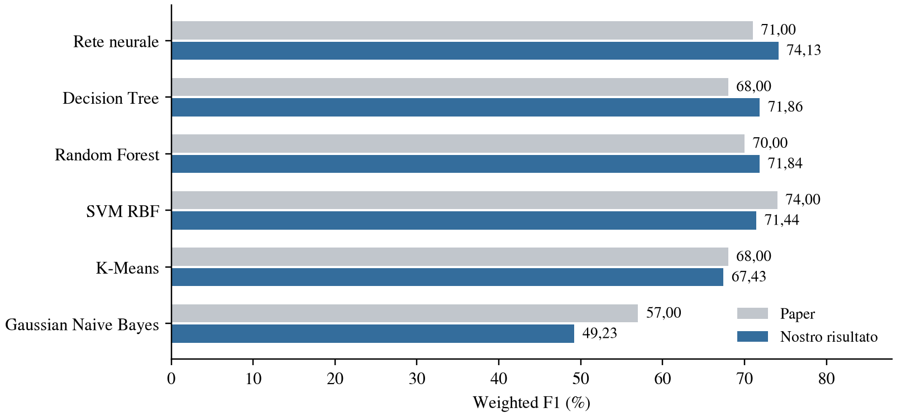
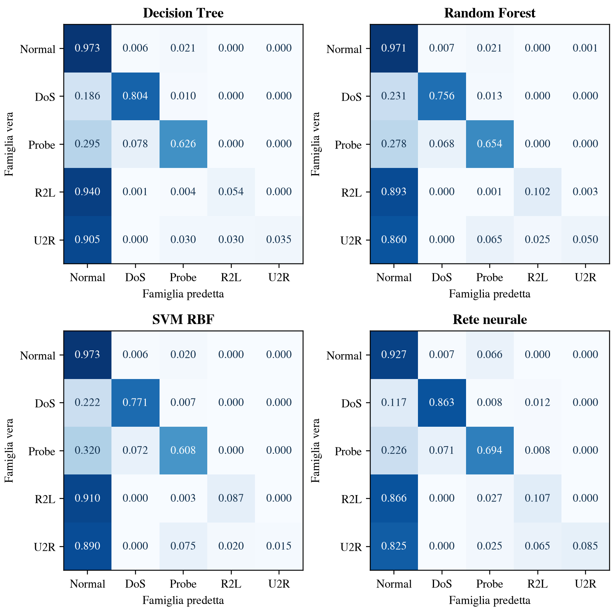
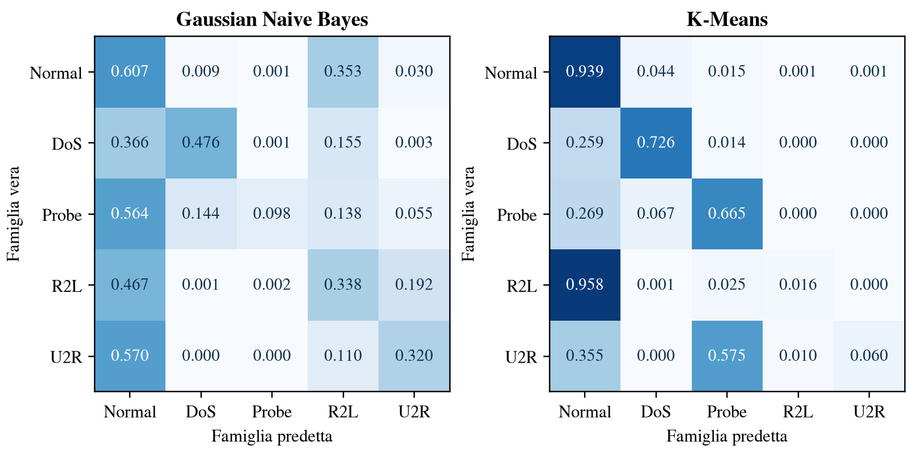
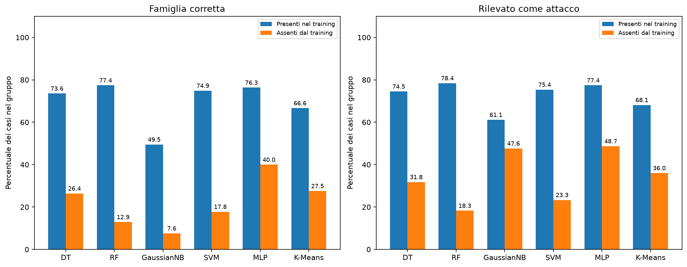
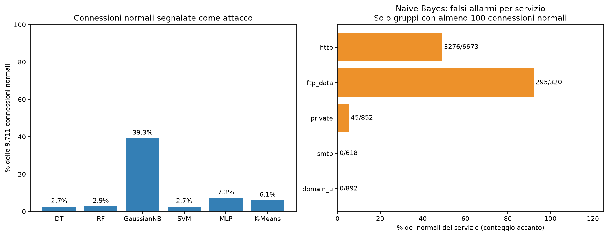
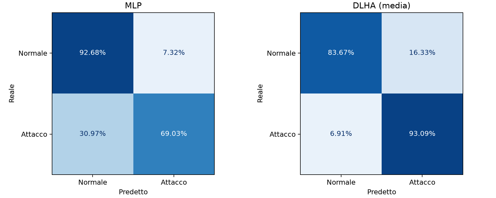

# Analisi dei dataset per prevedere il traffico e riconoscere le anomalie

Tommaso Pizzolato · Progetto di tesi all’Università di Ferrara

[PDF completo](docs/Tesi_Studio_Dataset_e_Decisioni.pdf) · [Notebook e istruzioni](notebooks/README.md) · [Scelta del prossimo dataset](docs/TEMPORAL_DATASETS.md)

Il lavoro parte dal confronto tra CESNET-TimeSeries26 e NSL-KDD. Su NSL-KDD ho valutato sei modelli, analizzato gli errori sulle classi rare e confrontato il rilevamento degli attacchi mai visti con una reimplementazione di DLHA.

[Dataset e obiettivi](#1-cesnet-timeseries26) · [Esperimenti NSL-KDD](#6-esperimenti-su-nsl-kdd) · [Confronto DLHA](#12-esperimento-conclusivo-con-dlha) · [Bibliografia](#bibliografia)

## 1. CESNET-TimeSeries26

CESNET-TimeSeries26 contiene misure del traffico della rete ceca CESNET3, raccolte da ottobre 2023 a giugno 2026. Per ogni indirizzo IP, sottorete o istituzione sono disponibili valori ogni 10 minuti, un’ora o un giorno. Le misure comprendono il numero di flussi, i pacchetti e i byte scambiati. Tabelle separate collegano ogni misura alla data e all’ora.

L’obiettivo è prevedere il traffico futuro e rilevare anomalie nel tempo. Alcuni eventi noti aiutano a controllare i risultati. La copertura delle etichette è parziale e un valore insolito può avere anche cause diverse da un attacco. Le prime 40 settimane delle serie presenti in CESNET-TimeSeries24 coincidono con quelle di CESNET-TimeSeries26. Riapplicare lo stesso codice a quelle settimane aggiungerebbe quindi poco al lavoro svolto. [Koumar et al., CESNET-TimeSeries26](https://arxiv.org/abs/2610.14799)

## 2. Indicazioni per gli esperimenti su CESNET26

La tabella riassume le indicazioni degli autori per impostare e confrontare gli esperimenti.

| N. | Indicazione |
|---:|---|
| 1 | Specificare quali parti del dataset si usano. |
| 2 | Indicare gli intervalli di aggregazione. |
| 3 | Dichiarare se l’approccio è univariato o multivariato. |
| 4 | Dichiarare esplicitamente se si usa solo una parte delle metriche. |
| 5 | Documentare il preprocessing, compresi filtri, normalizzazione e gestione dei dati mancanti. |
| 6 | Iniziare l’addestramento all’inizio del periodo della parte scelta: 9 ottobre 2023 per il dataset principale e la propria data di inizio nel 2022 per la sottorete longitudinale. |
| 7 | Specificare la durata della finestra di addestramento. |
| 8 | Descrivere la finestra di validazione, se usata. |
| 9 | Descrivere come si riaddestra il modello, se lo si riaddestra durante la valutazione. |
| 10 | Specificare l’orizzonte di previsione. |
| 11 | Specificare le metriche di valutazione. |
| 12 | Confrontare le serie tramite distribuzioni e statistiche aggregate. |
| 13 | Valutare e documentare i requisiti di calcolo e la possibilità di usare il modello in produzione. |
| 14 | Rendere pubblico il codice degli esperimenti e dei modelli. |
| 15 | Riportare i risultati complessivi e quelli per anno o sottoperiodo di valutazione, così da rendere visibili i cambiamenti del traffico. |
| 16 | Per modellare la stagionalità annuale, includere almeno un intero ciclo annuale nel training e dichiararlo. |
| 17 | Per favorire il confronto, usare per il training il periodo dal 9 ottobre 2023 all’8 ottobre 2025 e per il test i dati successivi. |

*Tabella 1. Adattamento in italiano della tabella 4 di [Koumar et al.](https://arxiv.org/abs/2610.14799), p. 18. Licenza [CC BY 4.0](https://creativecommons.org/licenses/by/4.0/).*

Il protocollo indica quali dati usare, come trattare le misure mancanti, quanto passato osservare e quanto avanti prevedere. Gli autori consigliano di misurare gli errori con RMSE, SMAPE e R² e confrontare i risultati tra serie e periodi.

## 3. NSL-KDD

NSL-KDD è una selezione del dataset KDD’99, ricavato dal traffico simulato dell’esperimento DARPA del 1998. Ogni riga descrive una connessione attraverso 41 caratteristiche numeriche o categoriche, come durata, protocollo, servizio e byte scambiati. I due insiemi contengono 125.973 connessioni per l’addestramento e 22.544 per il test.

L’obiettivo è rilevare e classificare le intrusioni. Le etichette distinguono le connessioni normali dai tipi di attacco, raggruppati in DoS, Probe, R2L e U2R. Nel test compaiono anche tipi di attacco assenti dall’addestramento.

Gli autori hanno eliminato i duplicati di KDD’99 e selezionato i record in base alla difficoltà di classificazione. Il traffico rimane storico e simulato. Le feature rappresentano la durata della connessione e altre proprietà, mentre il momento assoluto in cui è avvenuta è sconosciuto. Il protocollo mantiene gli insiemi originali e considera anche i risultati per classe e i falsi allarmi. [Tavallaee et al.](https://doi.org/10.1109/CISDA.2009.5356528) · [Documentazione UNB](https://www.unb.ca/cic/datasets/nsl.html)

## 4. Confronto tra CESNET26 e NSL-KDD

| Aspetto | NSL-KDD | CESNET-TimeSeries26 |
|---|---|---|
| Origine | Rete simulata del 1998 | Traffico reale di CESNET3, raccolta principale 2023–2026 |
| Una riga | Connessione descritta da 41 caratteristiche | Misure aggregate di un’entità in un intervallo |
| Struttura | Tabella di connessioni | Serie per IP, sottoreti e istituzioni |
| Tempo | Timestamp assoluto assente dalle feature | Intervalli regolari di 10 minuti, un’ora o un giorno |
| Obiettivo | Rilevare e classificare le intrusioni | Prevedere il traffico e rilevare anomalie nel tempo |
| Etichette | Connessione normale oppure tipo di attacco | Alcuni eventi documentati |
| Difficoltà principale | Rappresentatività e distribuzione delle classi | Dati mancanti, stagionalità e cambiamenti del traffico |

*Tabella 2. Confronto tra i dataset e i rispettivi obiettivi.*

Timestral è la prima scelta proposta per il forecasting su CESNET26. Per NSL-KDD il compito è la classificazione di dati tabellari. La struttura del codice per gli esperimenti può essere condivisa, adattando caricamento, modello e metriche ai due problemi.

## 5. Modelli per il forecasting su CESNET26

La prima scelta è [Timestral](https://mistral.ai/it/news/timestral/) di Mistral AI, un modello zero-shot. Tiny Time Mixer (TTM) è un modello IBM preaddestrato per la previsione di serie temporali. SARIMA è un modello statistico da adattare alla serie e può tenere conto di andamenti ripetuti, per esempio quelli settimanali.

[CESNET TS-Zoo](https://cesnet.github.io/cesnet-tszoo/) permette di caricare, preparare e dividere i dati tra addestramento, validazione e test. La libreria semplifica il confronto tra i dataset che supporta. Per gli altri dataset servono funzioni di caricamento dedicate.

## 6. Esperimenti su NSL-KDD

### Come è fatta una riga del dataset

Ogni riga descrive una connessione di rete. I file contengono **43 colonne** senza intestazione. I nomi vengono assegnati durante la lettura. I gruppi seguono la documentazione KDD e NSL-KDD e la distinzione tra feature di base, di contenuto e di traffico in Divekar et al. (sezione II-A).

| Posizione e gruppo | Colonne nell’ordine del file |
|---|---|
| 1–9 · Connessione | `duration`, `protocol_type`, `service`, `flag`, `src_bytes`, `dst_bytes`, `land`, `wrong_fragment`, `urgent` |
| 10–22 · Contenuto e accessi | `hot`, `num_failed_logins`, `logged_in`, `num_compromised`, `root_shell`, `su_attempted`, `num_root`, `num_file_creations`, `num_shells`, `num_access_files`, `num_outbound_cmds`, `is_host_login`, `is_guest_login` |
| 23–31 · Traffico recente | `count`, `srv_count`, `serror_rate`, `srv_serror_rate`, `rerror_rate`, `srv_rerror_rate`, `same_srv_rate`, `diff_srv_rate`, `srv_diff_host_rate` |
| 32–41 · Traffico verso host | `dst_host_count`, `dst_host_srv_count`, `dst_host_same_srv_rate`, `dst_host_diff_srv_rate`, `dst_host_same_src_port_rate`, `dst_host_srv_diff_host_rate`, `dst_host_serror_rate`, `dst_host_srv_serror_rate`, `dst_host_rerror_rate`, `dst_host_srv_rerror_rate` |
| 42 · Etichetta | `attack_label` identifica il traffico normale o il tipo specifico di attacco, da cui ricaviamo la famiglia da predire. |
| 43 · Difficoltà | `difficulty` indica quante classificazioni nell’analisi originaria erano corrette, su 21. Valori più alti indicano casi più facili. |

`duration` misura la durata in secondi, `protocol_type` indica il protocollo e `service` il servizio di destinazione. `flag` descrive lo stato della connessione, per esempio se si è conclusa regolarmente. `src_bytes` e `dst_bytes` misurano i byte nelle due direzioni. `count` e `srv_count` contano connessioni recenti. Le colonne `rate` sono proporzioni e `dst_host_*` riassume il traffico verso gli host di destinazione.

Esempio dalla prima riga di KDDTrain+, con alcuni campi selezionati:

```text
duration=0, protocol_type=tcp, service=ftp_data, flag=SF, src_bytes=491,
dst_bytes=0, …, attack_label=normal, difficulty=20
```

### Protocollo sul test ufficiale

Ho confrontato Decision Tree, Random Forest, Gaussian Naive Bayes, SVM RBF, MLP e K-Means. I modelli sono stati addestrati sul **100% di KDDTrain+** (125.973 connessioni) e valutati su **KDDTest+** (22.544 connessioni). Le cinque famiglie sono Normal, DoS, Probe, R2L e U2R.

Gli input sono le 41 feature, di cui 38 numeriche e tre categoriche (`protocol_type`, `service`, `flag`). Le categoriche sono codificate con one-hot. `attack_label` è il target di partenza e `difficulty` è esclusa dai predittori. L’encoder e lo scaler, quando previsto, apprendono dal training. Il MLP ha uno strato nascosto da 100 neuroni, attivazione ReLU e ottimizzatore Adam.

| Modello | Macro F1 | Recall R2L | Recall U2R |
|---|---:|---:|---:|
| MLP | **0,5469** | 10,71% | 8,50% |
| Random Forest | 0,5270 | 10,24% | 5,00% |
| Decision Tree | 0,5099 | 5,45% | 3,50% |
| SVM RBF | 0,5063 | 8,71% | 1,50% |
| K-Means | 0,4846 | 1,63% | 6,00% |
| Gaussian Naive Bayes | 0,3352 | 33,84% | 32,00% |

Il MLP ottiene il macro F1 più alto. Questa metrica fa la media dei punteggi F1 delle cinque classi. Le prestazioni sulle classi rare restano basse: il modello riconosce solo il 10,71% degli R2L e l’8,50% degli U2R. [Risultati e protocollo in dettaglio](docs/OFFICIAL_BENCHMARK_REPORT.md)

## 7. Confronto con il benchmark

Il confronto usa [la Tabella IV di Divekar et al. (2018)](https://arxiv.org/pdf/1811.05372), per NSL-KDD senza SMOTE. Il weighted F1 pesa i risultati per classe in base al numero di esempi. Le matrici di confusione normalizzate riportate più sotto mostrano invece il recall sulla diagonale.



*Figura 1. Weighted F1 riportato da Divekar et al. e misurato nei nostri esperimenti sul test ufficiale.*

| Modello | Normal | DoS | Probe | R2L | U2R |
|---|---:|---:|---:|---:|---:|
| Decision Tree | 77 / 78,65 | 84 / 87,54 | 66 / 71,75 | 3 / 10,31 | 12 / 6,73 |
| Random Forest | 79 / 78,06 | 87 / 84,62 | 70 / 73,35 | 0 / 18,52 | 4 / 8,93 |
| Gaussian Naive Bayes | 73 / 55,90 | 63 / 61,98 | 7 / 17,77 | 29 / 21,62 | 4 / 10,31 |
| SVM RBF | 80 / 77,88 | 84 / 85,59 | 72 / 70,72 | 31 / 16,01 | 12 / 2,94 |
| MLP | 79 / 79,35 | 85 / 91,11 | 74 / 68,92 | 3 / 18,61 | 5 / 15,45 |
| K-Means | 78 / 75,62 | 84 / 80,48 | 52 / 72,06 | 3 / 3,20 | 3 / 10,96 |

*F1 per classe in percentuale. In ogni cella, il primo valore viene dal paper e il secondo dai nostri esperimenti.*

Il weighted F1 del MLP è 74,13%, contro 71% nel paper. Anche gli autori riportano F1 bassi per R2L e U2R. Naive Bayes e SVM ottengono un weighted F1 inferiore a quello pubblicato. Il confronto è descrittivo perché feature, preprocessing e parametri differiscono. I risultati usano una configurazione per modello, senza tuning sul test.

## 8. Matrici di confusione

Le righe indicano la famiglia vera e le colonne quella predetta. Ogni riga somma a 1 e la diagonale mostra il recall. Tutti i pannelli usano la stessa scala.



*Figura 2. Matrici normalizzate per classe vera sul test ufficiale.*

Molti R2L e U2R sono classificati come Normal. Per esempio, il MLP riconosce 295 R2L su 2.754 e 17 U2R su 200.

## 9. Classi rare e falsi positivi



*Figura 3. Matrici normalizzate di Gaussian Naive Bayes e K-Means.*

Naive Bayes riconosce più R2L e U2R degli altri modelli, ma segnala come attacchi **3.813 connessioni normali su 9.711** (39,26%). La precision è 15,89% per R2L e 6,15% per U2R.

| Modello | Connessioni normali segnalate | % delle normali | FP R2L | FP U2R |
|---|---:|---:|---:|---:|
| Decision Tree | 258 | 2,66% | 7 | 1 |
| Random Forest | 277 | 2,85% | 9 | 14 |
| Gaussian Naive Bayes | 3.813 | 39,26% | 4.935 | 977 |
| SVM RBF | 258 | 2,66% | 5 | 1 |
| MLP | 711 | 7,32% | 122 | 3 |
| K-Means | 588 | 6,05% | 12 | 7 |

Un falso allarme è una connessione normale segnalata come attacco. I falsi positivi di una famiglia includono tutti i casi delle altre classi assegnati a quella famiglia, compresi altri tipi di attacco. Per capire il compromesso sulle classi rare, leggo recall e precision insieme.

## 10. Attacchi presenti e assenti nel training

Il test contiene **9.083 attacchi di tipi presenti nel training**, **3.750 attacchi di tipi assenti** e **9.711 connessioni normali**. La distinzione riguarda il nome specifico dell’attacco. Tutte le famiglie erano già rappresentate nel training.



*Figura 4. Percentuali di famiglia corretta e di rilevamento nei due gruppi di attacchi.*

Tutti i modelli assegnano meno spesso la famiglia corretta ai tipi assenti. Per il MLP, la quota scende da **76,33% a 39,97%**. Anche alcuni tipi già presenti nel training vengono quasi sempre persi.

| Attacco | Casi nel training / test | Esito del MLP |
|---|---:|---|
| `guess_passwd` (R2L) | 53 / 1.231 | Tutti i 1.231 casi classificati Normal. |
| `warezmaster` (R2L) | 20 / 944 | 291 su 944 nella famiglia corretta. |
| `httptunnel` (U2R) | 0 / 133 | 1 su 133 nella famiglia corretta e 130 classificati Normal. |

I primi due tipi contano per 2.175 dei 2.754 R2L del test. `httptunnel` rappresenta 133 dei 200 U2R (66,5%) con la mappatura adottata. Su `httptunnel`, K-Means segnala 113 casi su 133 come attacchi e ne assegna uno a U2R. Il confronto tra tipi presenti e assenti combina differenze nelle frequenze e nelle feature, quindi descrive gli errori senza isolarne la causa. Le percentuali su pochissimi casi vanno lette con i conteggi. Per esempio, il 100% del MLP su `loadmodule` corrisponde a due casi su due. [Diagnosi per tipo di attacco](docs/ATTACK_DIAGNOSIS.md)

## 11. Falsi allarmi e conclusioni del benchmark



*Figura 5. A sinistra il denominatore è 9.711 connessioni normali. A destra è il numero di connessioni normali per servizio. Sono mostrati i servizi con almeno 100 connessioni normali.*

Dei **3.813 falsi allarmi** di Naive Bayes, **3.642** riguardano connessioni che tutti gli altri modelli classificano come Normal. Gli errori si concentrano soprattutto su HTTP (3.276 su 6.673) e FTP-data (295 su 320). Le assegnazioni errate più frequenti sono R2L (3.424 casi) e U2R (291). Le associazioni con servizi e feature descrivono gli errori senza dimostrarne la causa.

Il MLP ha ottenuto il miglior macro F1 tra le configurazioni provate e ha lasciato sfuggire gran parte degli R2L e U2R. La difficoltà riguarda sia tipi di attacco nuovi sia alcuni già presenti, come `guess_passwd`. Rilevamento, classificazione della famiglia e falsi allarmi vanno quindi valutati insieme. Il benchmark è un confronto tra configurazioni specifiche e, per i modelli stocastici, un singolo seed. [Analisi dei falsi allarmi](docs/FALSE_ALARMS_AND_CONCLUSIONS.md)

## 12. Esperimento conclusivo con DLHA

Ho reimplementato DLHA, il metodo di Wisanwanichthan e Thammawichai (2021). Il primo stadio usa Naive Bayes per cercare DoS e Probe. Il secondo usa una SVM per esaminare le connessioni rimanenti. I due stadi vengono addestrati con dati di KDDTrain+. Su KDDTest+ il confronto è binario: qualunque predizione di attacco del MLP conta come allarme.

| Metodo | Attacchi di tipi presenti rilevati | Attacchi di tipi assenti rilevati | Falsi allarmi |
|---|---:|---:|---:|
| MLP | 77,43% | 48,69% | 7,32% |
| Reimplementazione DLHA | 94,08% | **90,68%** | 16,33% |
| DLHA nel paper | 94,01% | 90,96% | 11,82% |

Il test comprende 9.083 attacchi di tipi presenti, 3.750 di tipi assenti e 9.711 connessioni normali. La reimplementazione riporta la media di cinque prove con diversi campioni di normali per l’addestramento della SVM. Il 90,96% si ricava dai conteggi pubblicati. Gli autori riportano l’11,82% di falsi allarmi, mentre dai conteggi e dalla precision si stima circa il 16,5% sui normali.


*Figura 6. Rilevamento e falsi allarmi misurati sullo stesso test.*



*Figura 7. Matrici di confusione binarie, normalizzate per classe vera.*

Rispetto al MLP, la cascata aumenta di **41,98 punti percentuali** il rilevamento dei tipi assenti e di **9,00 punti** i falsi allarmi, calcolati prima dell’arrotondamento. Il rilevamento dei tipi assenti è vicino ai conteggi pubblicati. Il confronto resta descrittivo perché alcuni dettagli del preprocessing sono stati ricostruiti e il test era già stato analizzato. [Report DLHA](docs/DLHA_OFFICIAL_COMPARISON.md)

## Bibliografia

- UCI KDD Archive. *KDD Cup 1999*. [Descrizione](https://kdd.ics.uci.edu/databases/kddcup99/task.html) · [Schema delle feature](https://kdd.ics.uci.edu/databases/kddcup99/kddcup.names)
- Tavallaee, M., Bagheri, E., Lu, W., e Ghorbani, A. A. (2009). *A Detailed Analysis of the KDD CUP 99 Data Set*. CISDA. [Articolo](https://doi.org/10.1109/CISDA.2009.5356528) · [PDF](https://www.ee.torontomu.ca/~bagheri/papers/cisda.pdf)
- University of New Brunswick. *ISCX NSL-KDD dataset 2009*. [Documentazione](https://www.unb.ca/cic/datasets/nsl.html)
- Divekar, A. et al. (2018). *Benchmarking datasets for Anomaly-based Network Intrusion Detection: KDD CUP 99 alternatives*. [Articolo](https://arxiv.org/pdf/1811.05372)
- Wisanwanichthan, T., e Thammawichai, M. (2021). *A Double-Layered Hybrid Approach for Network Intrusion Detection System Using Combined Naive Bayes and SVM*. IEEE Access, 9, 138432–138450. [Articolo](https://doi.org/10.1109/ACCESS.2021.3118573)
- Koumar, J., Hynek, K., Jeřábek, K., e Šiška, P. (2026). *CESNET-TimeSeries26: A Multi-Year Network Traffic Time Series Dataset for Annual Seasonality, Concept Drift, and Long-Term Anomaly Detection*. [Preprint](https://arxiv.org/abs/2610.14799)
- Mistral AI (2026). *Presentiamo Timestral*. [Presentazione](https://mistral.ai/it/news/timestral/) · [Codice](https://github.com/mistralai/timestral)
- Koumar, J., Smoleň, T., Jeřábek, K., e Čejka, T. (2025). *Comparative Analysis of Deep Learning Models for Real-World ISP Network Traffic Forecasting*. [Preprint](https://arxiv.org/abs/2503.17410) · [Codice](https://github.com/koumajos/isp-forecasting-benchmark/tree/56ad07db39f4bab508882d29e39c1f639702a5a4)
- Liu, F., Farkiani, B., e Crowley, P. (2025, aggiornato nel 2026). *Time-Series Foundation Models for ISP Traffic Forecasting*. [Preprint](https://arxiv.org/abs/2511.17529) · [Codice](https://github.com/FanL1u/TSFM-for-ISP-traffic-forecasting/tree/e2ff6d5acc315a7aa5dfd81cb568a0ce72654501)
- tanjilaahmed2. *CESNET Anomaly Detection (SARIMA-Based)*. [Notebook](https://github.com/tanjilaahmed2/cesnet-anomaly-detection/tree/9ceb3a702f837b708b1cf2804f3f1516da2d5933)
- CESNET. *CESNET TS-Zoo*. [Documentazione](https://cesnet.github.io/cesnet-tszoo/)
