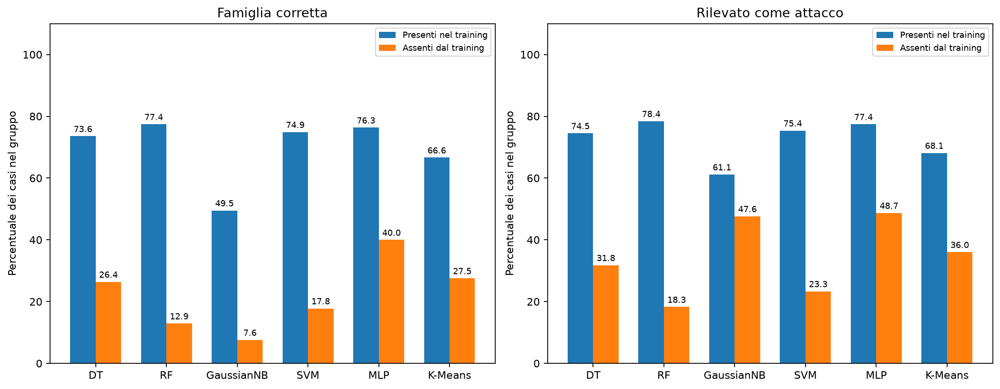
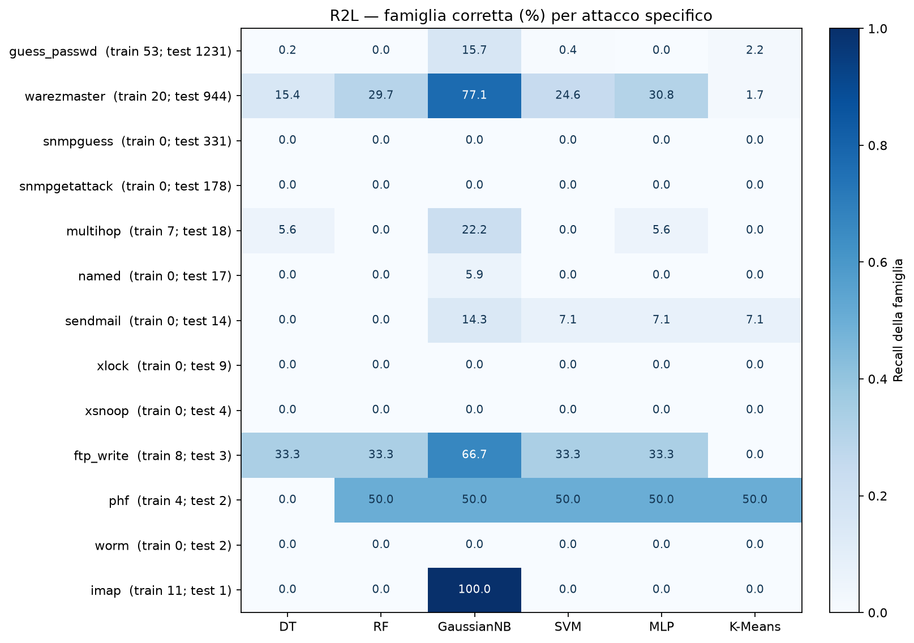
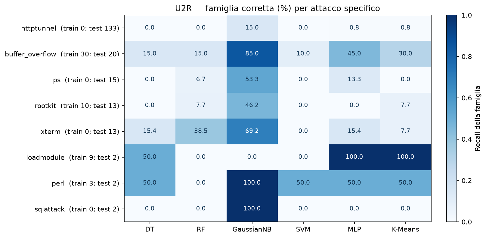

# NSL-KDD — Diagnosi degli attacchi e delle classi rare

7 novembre 2026. T38 e T39: analisi delle predizioni già salvate, senza nuovi addestramenti.

## Cosa emerge

1. Tutti i modelli classificano peggio gli attacchi il cui nome specifico era assente
   dal training. Per la rete neurale la quota di famiglie corrette scende dal
   **76,33% al 39,97%**.
2. Il problema non riguarda soltanto attacchi nuovi: `guess_passwd` è presente nel
   training, ma RF e rete neurale classificano tutti i suoi **1.231 casi di test
   come Normal**.
3. In U2R pesa molto `httptunnel`: **133 dei 200 casi**, tutti assenti dal training.
   Il suo riconoscimento come U2R è debole in tutti i modelli; a volte viene rilevato
   come attacco ma assegnato alla famiglia sbagliata.

## 1. Attacchi presenti e assenti nel training

Nel test ci sono **9.083 attacchi di tipi presenti nel training**, **3.750 di tipi
assenti** e **9.711 connessioni Normal**, tenute separate dal confronto degli attacchi.
"Presente" riguarda il nome specifico dell'attacco, non l'identità della singola
connessione. Non compaiono nuove famiglie: i modelli conoscevano già tutte e cinque.

**Famiglia corretta** significa predire la famiglia vera. **Rilevato come attacco**
significa predire una qualunque delle quattro famiglie di attacco: per esempio un
U2R classificato Probe è rilevato, ma la sua famiglia è sbagliata.

| Modello | Famiglia corretta: presenti | Famiglia corretta: assenti | Rilevati come attacco: assenti |
|---|---|---|---|
| Decision Tree | 73,55% | 26,40% | 31,79% |
| Random Forest | 77,42% | 12,91% | 18,27% |
| Gaussian Naive Bayes | 49,50% | 7,60% | 47,63% |
| SVM RBF | 74,89% | 17,79% | 23,33% |
| Rete neurale | 76,33% | 39,97% | 48,69% |
| K-Means | 66,62% | 27,55% | 36,03% |

Questi valori sono percentuali di casi corretti nei gruppi, non F1. Il rilevamento
sui soli attacchi non misura i falsi allarmi: il valore relativamente alto di
Naive Bayes va letto insieme ai molti falsi positivi già emersi nel confronto precedente.

### Confronto entro famiglia: esempio della rete neurale

La composizione dei gruppi è diversa. Per evitare di attribuire tutto il divario
alla novità, guardiamo anche entro ciascuna famiglia. Usiamo come esempio il MLP,
che aveva il macro F1 complessivo più alto nel confronto precedente; i valori
di tutti i sei modelli sono nel notebook22 e nel CSV associato.

| Famiglia | Test: presenti | Recall famiglia | Test: assenti | Recall famiglia |
|---|---|---|---|---|
| DoS | 5741 | 98,57% | 1717 | 45,43% |
| Probe | 1106 | 87,52% | 1315 | 54,22% |
| R2L | 2199 | 13,37% | 555 | 0,18% |
| U2R | 37 | 32,43% | 163 | 3,07% |

Il calo è presente anche entro le quattro famiglie per questo modello. Resta un
confronto descrittivo: tipo di attacco, frequenza e distribuzione delle feature
cambiano insieme, quindi non possiamo attribuire causalmente il divario alla sola
assenza dal training.

## 2. Quali attacchi pesano su R2L e U2R

Conteggi assegnati alla **famiglia corretta**, sul totale di casi di quel tipo nel test:

| Modello | guess_passwd (R2L) | warezmaster (R2L) | httptunnel (U2R) |
|---|---|---|---|
| Decision Tree | 3/1231 | 145/944 | 0/133 |
| Random Forest | 0/1231 | 280/944 | 0/133 |
| Gaussian Naive Bayes | 193/1231 | 728/944 | 20/133 |
| SVM RBF | 5/1231 | 232/944 | 0/133 |
| Rete neurale | 0/1231 | 291/944 | 1/133 |
| K-Means | 27/1231 | 16/944 | 1/133 |

- **guess_passwd:** 53 esempi nel training, 1.231 nel test. È il gruppo R2L più
  numeroso e rimane molto difficile, pur essendo già presente nel training.
- **warezmaster:** 20 esempi nel training, 944 nel test. Con guess_passwd rappresenta
  2.175 dei 2.754 R2L del test. I due tipi già presenti concentrano quindi gran
  parte dei casi di questa famiglia.
- **httptunnel:** nessun esempio nel training e 133 nel test. È il **66,5% degli U2R**
  secondo la convenzione degli autori adottata nel protocollo. La rete neurale
  ne assegna 130 a Normal e soltanto uno a U2R.

La distinzione tra rilevamento e famiglia conta: per `httptunnel`, K-Means riconosce
**113 casi su 133 come attacchi**, ma soltanto **uno come U2R**. Il solo recall di
rilevamento nasconderebbe questo errore di classificazione.

### Tutti gli attacchi R2L del test

### Tutti gli attacchi U2R del test

Le righe riportano i supporti nel training e nel test. I gruppi con uno o pochi
casi non permettono conclusioni robuste: per esempio il 100% della rete neurale
su loadmodule significa soltanto **2 casi corretti su 2**.

## Lettura conclusiva

La generalizzazione a tipi assenti dal training è un limite evidente, ma non è
l'unico. Anche alcuni attacchi già presenti vengono quasi sempre persi. La diagnosi
non giustifica quindi la conclusione "basta aggiungere esempi dei nuovi attacchi".

Per R2L il prossimo punto da comprendere sarebbe soprattutto `guess_passwd`; per
U2R, `httptunnel` e gli errori verso altre famiglie. Nessun parametro è stato cambiato
e nessuna nuova configurazione è stata provata sulla base di questi risultati.

Notebook: [22 — presenti/assenti](../notebooks/22_seen_unseen_attacks.ipynb) e
[23 — attacchi R2L/U2R](../notebooks/23_rare_attack_subtypes.ipynb).
Tabelle complete in artifacts/seen_unseen_attacks e artifacts/rare_attack_subtypes.
Il PDF del resoconto non è stato modificato in questo blocco.
