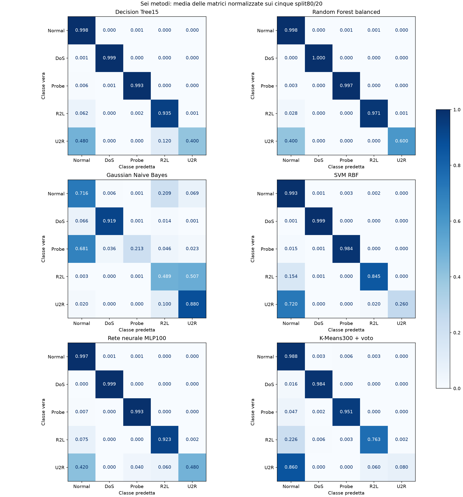

# Confronto completo dei sei metodi — T21–T26

Misurato il 2 novembre 2026. Copertura dei sei tipi di modello di Divekar et al.,
non esecuzione del suo protocollo ufficiale o replica numerica della TabellaIV.

[11 Rete neurale](../notebooks/11_neural_network.ipynb) →
[12 K-Means](../notebooks/12_kmeans.ipynb) →
[13 Confronto completo](../notebooks/13_benchmark_comparison.ipynb).

## Protocollo

KDDTrain+: 125973 record, 41 feature e cinque famiglie. Cinque split 80/20 stratificati
seed 1–5; 100778 train / 25195 validation: stessi hash, indici e target dei riferimenti.
Cinque nuovi fit MLP seguiti da cinque fit K-Means; nessun altro modello riaddestrato.
Il confronto 13 esegue zero fit e ricalcola i risultati dalle predizioni salvate.
Dieci inizializzazioni interne per fit K-Means, 50 ottimizzazioni totali, scelte per
inerzia sul training. Nessun tuning supervisionato o selezione dopo i risultati.

38 numeriche standardizzate e 3 categoriche one-hot denso per entrambi i nuovi modelli,
preprocessing train-only in Pipeline. Seed variato anche per inizializzazione:
la DS combina variazione dello split e del training, non le isola.
Tutti i 41 predittori conservati, nessun target/difficulty tra gli input.
RF/albero pesato usano pesi balanced e numeriche non scalate; gli altri metodi
non ricevono pesi aggiunti. Non si isola causalmente l'effetto dell'algoritmo.

## Configurazioni fissate prima del training

- MLPClassifier: hidden_layer_sizes=(100,), activation=relu,solver=adam,
  alpha=0.0001, batch_size=auto,learning_rate_init=0.001,max_iter=300,tol=0.0001,
  n_iter_no_change=10,early_stopping=False. Stopping sulla loss di training;
  nessuna lettura della validation esterna. Curve, epoche e warning salvati.
- KMeans: n_clusters=300,init=k-means++,n_init=10,max_iter=300,tol=0.0001,
  algorithm=lloyd. Fit senza y. Voto maggioranza dai soli cluster training;
  parità risolta con FAMILY_ORDER, vuoti con maggioranza globale training.
  Mappatura congelata prima della predizione di validation, mai ri-etichettata.

Il paper descrive 1–3 strati da 20–100 neuroni e 300–400 cluster. Sono nostre scelte
la singola architettura da 100 neuroni, i 300 cluster e lo spareggio deterministico, diverso
da quello casuale del paper. Differiscono anche encoding, 41 feature e protocollo;
vedere [BENCHMARK.md](BENCHMARK.md). Nessuna replica esatta promessa.

## Risultati sulle cinque prove

Medie per run e DS campionaria (ddof=1), non intervalli di confidenza.

| Modello | Accuracy | Macro F1 media ± DS | Weighted F1 |
|---|---|---|---|
| Decision Tree15 | 99.73% | 0.8754 ± 0.0550 | 0.9973 |
| Random Forest balanced | 99.83% | 0.9200 ± 0.0312 | 0.9982 |
| Gaussian Naive Bayes | 74.18% | 0.4344 ± 0.0383 | 0.7834 |
| SVM RBF | 99.32% | 0.8406 ± 0.0352 | 0.9931 |
| Rete neurale MLP100 | 99.68% | 0.8921 ± 0.0377 | 0.9968 |
| K-Means300 + voto | 98.10% | 0.7593 ± 0.0481 | 0.9808 |

| Modello | Precision U2R | Recall U2R | Errore U2R | FP U2R/run | Precision R2L | Recall R2L | Errore R2L |
|---|---|---|---|---|---|---|---|
| Decision Tree15 | 49.62% | 40.00% | 60.00% | 3.2 | 95.98% | 93.47% | 6.53% |
| Random Forest balanced | 78.34% | 60.00% | 40.00% | 2.2 | 94.83% | 97.09% | 2.91% |
| Gaussian Naive Bayes | 0.80% | 88.00% | 12.00% | 1089.0 | 6.06% | 48.94% | 51.06% |
| SVM RBF | 62.33% | 26.00% | 74.00% | 1.6 | 88.45% | 84.52% | 15.48% |
| Rete neurale MLP100 | 65.12% | 48.00% | 52.00% | 2.6 | 96.14% | 92.26% | 7.74% |
| K-Means300 + voto | 11.43% | 8.00% | 92.00% | 1.6 | 78.98% | 76.28% | 23.72% |

| Modello | Normal: errore | DoS: errore | Probe: errore | R2L: errore | U2R: errore |
|---|---|---|---|---|---|
| Decision Tree15 | 0.18% | 0.09% | 0.68% | 6.53% | 60.00% |
| Random Forest balanced | 0.18% | 0.03% | 0.29% | 2.91% | 40.00% |
| Gaussian Naive Bayes | 28.38% | 8.13% | 78.65% | 51.06% | 12.00% |
| SVM RBF | 0.67% | 0.06% | 1.60% | 15.48% | 74.00% |
| Rete neurale MLP100 | 0.28% | 0.05% | 0.69% | 7.74% | 52.00% |
| K-Means300 + voto | 1.19% | 1.61% | 4.93% | 23.72% | 92.00% |

La RF balanced conserva il miglior macro F1 medio tra queste configurazioni.
Rimane però un errore medio U2R del 40%: il problema delle classi rare non è risolto.
La rete migliora macro F1 e recall U2R rispetto a SVM, ma non supera la RF;
la precision R2L leggermente maggiore accompagna un recall inferiore.
NB riconosce molti U2R generando però 1089 falsi positivi U2R/run: quel recall da solo
non indica un buon classificatore. K-Means riconosce solo l'8% degli U2R:
ogni training elegge almeno un cluster U2R, ma quattro validation su cinque
non contengono alcun U2R riconosciuto correttamente.
Le statistiche sono descrittive su holdout sovrapposti, non prove di significatività.

## Rete neurale MLP100 — risultato misurato e ricontrollato

Cinque fit sugli split 80/20 seed 1–5. **Macro F1 medio 0.892143 ± 0.037730 DS**, accuracy 99.68%.

| Famiglia | Precision | Recall | Errore | FP medi/run |
|---|---|---|---|---|
| R2L | 96.14% | 92.26% | 7.74% | 7.4 |
| U2R | 65.12% | 48.00% | 52.00% | 2.6 |

Epoche per seed 1–5: [78, 72, 79, 95, 83]; warning registrati: 0. La loss si riferisce al training; non decide il modello usando la validation esterna.

Rispetto alla RF già disponibile, macro F1 e recall delle due classi rare sono inferiori. Su R2L la precision è leggermente maggiore, con più attacchi persi. Il risultato non giustifica dichiarare questa architettura superiore alla RF.

| Seed | Epoche | Limite raggiunto | Warning | Fit: secondi |
|---|---|---|---|---|
| 1 | 78 | False | 0 | 26.05 |
| 2 | 72 | False | 0 | 23.29 |
| 3 | 79 | False | 0 | 26.34 |
| 4 | 95 | False | 0 | 31.26 |
| 5 | 83 | False | 0 | 27.06 |

Metriche ricalcolate indipendentemente dai NPZ. Stessi indici e target dei riferimenti; le validation si sovrappongono e riutilizzano 31 U2R distinti. Il confronto non è un test ufficiale o una replica numerica del paper.

## K-Means300 + voto — risultato misurato e ricontrollato

Cinque fit sugli split 80/20 seed 1–5. **Macro F1 medio 0.759312 ± 0.048075 DS**, accuracy 98.10%.

| Famiglia | Precision | Recall | Errore | FP medi/run |
|---|---|---|---|---|
| R2L | 78.98% | 76.28% | 23.72% | 42.8 |
| U2R | 11.43% | 8.00% | 92.00% | 1.6 |

Famiglie che non eleggono alcun cluster, per seed: `{1: [], 2: [], 3: [], 4: [], 5: []}`. Se una famiglia non vince alcun voto non può essere predetta: precision e recall restano a zero, senza eliminarla dalla matrice o dal macro F1.

In queste prove tutte le famiglie eleggono almeno un cluster nel training. I casi U2R corretti nei seed 1–5 sono [0, 4, 0, 0, 0]: quattro split non ne riconoscono nessuno. Il limite osservato non deriva dalla totale assenza di un cluster U2R nel training; gli assegnamenti non riconoscono bene gli U2R lasciati in validation.

Il voto è stato ricalcolato dalle sole etichette training e i cluster di validation ricontrollati dai centroidi salvati. Non ri-etichettiamo i cluster per migliorare la matrice.

| Seed | Iterazioni del restart scelto | Limite raggiunto | Warning | Fit: secondi |
|---|---|---|---|---|
| 1 | 46 | False | 0 | 59.46 |
| 2 | 36 | False | 0 | 58.45 |
| 3 | 54 | False | 0 | 60.23 |
| 4 | 29 | False | 0 | 57.77 |
| 5 | 44 | False | 0 | 62.98 |

Metriche ricalcolate indipendentemente dai NPZ. Stessi indici e target dei riferimenti; le validation si sovrappongono e riutilizzano 31 U2R distinti. Il confronto non è un test ufficiale o una replica numerica del paper.

## Variante albero pesato

L'albero di profondità 15 balanced è riportato separatamente nel notebook 13: macro F1
0.8106 ± 0.0375,
recall U2R 58.00%,
FP U2R/run 24.2.
Non è un settimo metodo del paper.

## Riprodurre e verificare

Ambiente e download nel [README](../README.md). Da copia senza artefatti:
04(cinque seed 1–5) →05(snapshot senza fit) →06 →07 →09 →10 →11 →12 →13.
Se i riferimenti esistono non vanno riaddestrati. Usare kernel Python (NSL-KDD)
pulito e lanciare ciascun notebook dall'inizio;11/12 eseguono cinque fit ciascuno,
13 zero. HTML già eseguiti e figure in artifacts/, esclusi da Git.

Ogni modello salva schema2, parametri completi per seed, versioni, split/hash,
tempi, warning, controlli scaler/encoder e metriche per run/classe con riepiloghi.
NPZ Unicode senza pickle. KMeans salva anche train_indices/train_clusters/centroidi,
cluster di validation, contingenze e mapping per ricontrollare il voto.
13 rifiuta schema/identità/protocolli o indici/target discordanti, ricalcola tutte
le metriche e salva media/DS/min/max, CM media/DS e delta abbinati vsRF.

Test delle celle reali: validation abbinata, classe mai predetta, voto training,
pareggi e cluster vuoti, lettura di artefatti validi e rifiuto di quelli discordanti.
Audit indipendente numpy dei NPZ, dei voti/centroidi e delle statistiche di training;
hash dei 68 file precedenti protetti e log in .local/nn-kmeans/.
Il test ufficiale resta separato; i duplicati noti sono conservati(DATA_AUDIT.md).
Le validation riutilizzano 31 U2R distinti,10 per run. Il 70/30 rimane separato.

## Fonti delle API

[MLPClassifier](https://scikit-learn.org/stable/modules/generated/sklearn.neural_network.MLPClassifier.html),
[KMeans](https://scikit-learn.org/stable/modules/generated/sklearn.cluster.KMeans.html).
I parametri effettivamente eseguiti sono registrati nei JSON locali, sklearn 1.9.1.

## Verifica e revisione finale

Tre notebook eseguiti da kernel pulito, zero errori. Cinque fit MLP e cinque
K-Means (50 inizializzazioni interne); nessun fit ripetuto dei riferimenti.
Suite completa:67 test superati,26 casi nuovi osservati RED→GREEN.
Le metriche, i riepiloghi, le matrici e i delta sono stati ricontrollati dai NPZ
con conteggi numpy; scaler/encoder training-only e voto/centroidi K-Means verificati.
I68file precedenti protetti sono invariati.

Review indipendente: nessun Critical. Corretto un rilievo importante sui controlli
del confronto: un NPZ di un altro modello con stessi indici e target poteva essere
attribuito al JSON sbagliato. I notebook11/12/13 confrontano ora i conteggi per run
ricalcolati dalle predizioni con quelli registrati nel JSON; nove regressioni
RED→GREEN per gli schemi vecchio/nuovo e per una predizione alterata ma valida.
Confronti rieseguiti senza fit,39file dei due nuovi modelli byte-identici.
Questo è un controllo di coerenza delle misure, non un'autenticazione crittografica.

Due dettagli minori rinviati alla preparazione GitHub: il PNG incorporato nel
reportMarkdown è locale sotto artifacts/; il notebook13 contiene già la figura.
Le istruzioni dell'ambiente dovranno indicare i limiti usati dal runner,
OPENBLAS_NUM_THREADS=2 e OMP_NUM_THREADS=2 prima di avviare il kernel.
