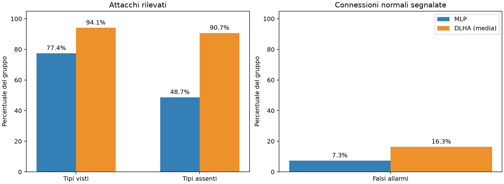
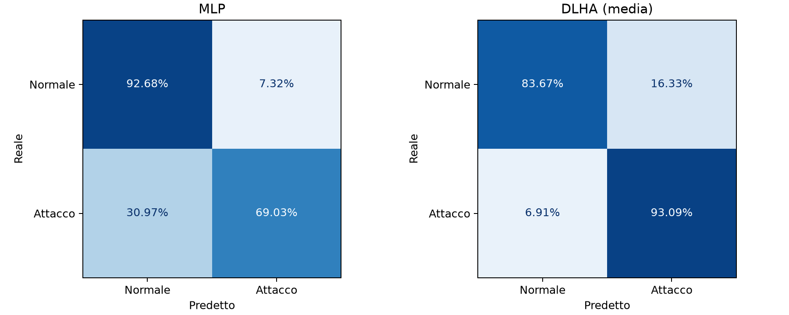

# NSL-KDD — Ultimo esperimento con DLHA

Abbiamo reimplementato **DLHA**, il metodo di [Wisanwanichthan e Thammawichai (IEEE Access, 2021)](https://doi.org/10.1109/ACCESS.2021.3118573). Gaussian Naive Bayes cerca DoS e Probe. Una SVM RBF esamina le connessioni rimaste, dopo essere stata addestrata su R2L, U2R e un campione di normali. Le trasformazioni sono state stimate sui dati di `KDDTrain+` pertinenti a ciascuno stadio. La media DLHA viene da cinque campioni di normali sullo stesso test.

| Metodo | Rilevati su 9.083 attacchi visti | Rilevati su 3.750 attacchi assenti | Falsi allarmi su 9.711 normali |
|---|---:|---:|---:|
| MLP | 77,43% | 48,69% | 7,32% |
| Nostra reimplementazione DLHA | 94,08% | 90,68% | 16,33% |
| DLHA, risultati pubblicati | 94,01% | 90,96% dai conteggi | 11,82% riportato, circa 16,5% ricavato |

La differenza rispetto al MLP è di **+41,98 punti** di rilevamento dei tipi assenti e **+9,00 punti** di falsi allarmi. Il rilevamento DLHA sui tipi assenti varia tra **90,37%** e **90,91%** nei cinque campionamenti. L'esito misura se scatta un allarme. L'uscita DLHA è binaria.

Il paper riporta 3.411 rilevati su 3.750 tipi assenti, pari al 90,96% dai conteggi. Per i falsi allarmi l'11,82% pubblicato è incoerente con la stima di circa 16,5% sui normali, ottenuta da precisione e veri positivi. Le nostre percentuali usano direttamente la matrice di confusione. Abbiamo riprodotto i 28 e 13 componenti PCA adottando la scala [0,1] dell'equazione 4 e mantenendo le tre categoriche. Il notebook specifica le colonne, il campionamento bilanciato dei normali e i cinque seed da 1 a 5. Il confronto con il paper è descrittivo.

[Notebook](../notebooks/25_dlha_official_test.ipynb)
