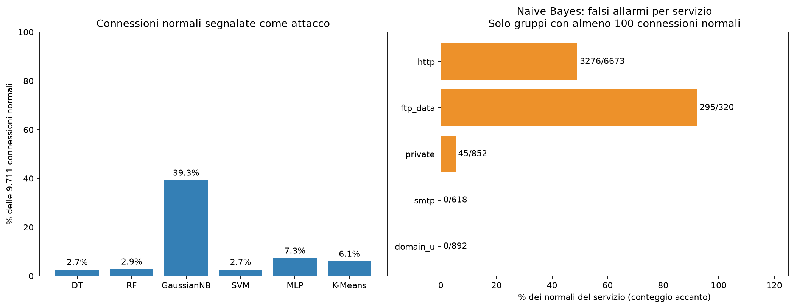

# NSL-KDD — Falsi allarmi e conclusione del confronto

7 novembre 2026 — T40 e T41.

## Falsi allarmi sulle connessioni normali

Un falso allarme è una connessione Normal segnalata come attacco. Il denominatore è costituito dalle 9.711 connessioni normali del test ufficiale.

| Modello | Falsi allarmi | Tasso sui normali |
|---|---:|---:|
| Decision Tree | 258 | 2,66% |
| Random Forest | 277 | 2,85% |
| Gaussian Naive Bayes | 3813 | 39,26% |
| SVM RBF | 258 | 2,66% |
| Rete neurale | 711 | 7,32% |
| K-Means | 588 | 6,05% |

Il grafico dei servizi include solo gruppi con almeno 100 connessioni normali; la tabella seguente comprende anche gruppi più piccoli.

## Dove sbaglia Naive Bayes

| Servizio | Normali nel test | Falsi allarmi | Tasso nel servizio |
|---|---:|---:|---:|
| http | 6673 | 3276 | 49,09% |
| ftp_data | 320 | 295 | 92,19% |
| other | 65 | 56 | 86,15% |
| ftp | 48 | 48 | 100,00% |
| ecr_i | 48 | 46 | 95,83% |
| private | 852 | 45 | 5,28% |

La tabella ordina i servizi per numero di falsi allarmi: i tassi hanno denominatori diversi e non vanno confusi con il peso del servizio sul totale degli errori.

**3642 falsi allarmi sono esclusivi di Naive Bayes**: gli altri cinque modelli classificano correttamente quelle connessioni come Normal. Questo descrive il disaccordo fra le configurazioni, non ne dimostra la causa.

Dei 3.813 falsi allarmi di Naive Bayes, **3.424 vengono assegnati a R2L e 291 a U2R**: il problema pesa proprio sulle famiglie per cui sembra migliore guardando soltanto il recall. La maggior parte riguarda TCP (3.705 su 7.842 normali TCP, 47,25%); per UDP sono 62 su 1.776 (3,49%). Anche il flag più frequente, SF, contiene 3.773 falsi allarmi su 9.607 normali. Questi gruppi si sovrappongono e non vanno sommati.

Il notebook contiene anche i gruppi per protocollo e stato della connessione (`flag`), le destinazioni errate e mediane/quartili delle feature numeriche. Le differenze fra gruppi non sono importanze delle feature e non giustificano da sole la loro eliminazione.

## Cosa abbiamo concluso su NSL-KDD

- Il confronto previsto è completo: sei modelli addestrati sul 100% di KDDTrain+ e valutati su KDDTest+, con le stesse cinque famiglie.
- Il MLP ha il macro F1 più alto tra le configurazioni provate (0,5469), ma il recall resta basso su R2L (10,71%) e U2R (8,50%). Non emerge un modello soddisfacente per tutte le classi.
- Tutti e sei i modelli assegnano meno spesso la famiglia corretta ai tipi assenti dal training. Questo però non spiega tutti gli errori: RF e MLP perdono anche tutti i 1.231 guess_passwd del test, un tipo già presente nel training.
- Il recall più alto di Naive Bayes sulle classi rare si accompagna a molti falsi positivi. Rilevare un attacco, assegnargli la famiglia corretta e contenere i falsi allarmi sono obiettivi distinti.
- Il confronto con Divekar è descrittivo: non è una replica esatta. Una configurazione e un seed sul test ufficiale non dimostrano una superiorità generale.

## Proposta per il passo successivo

**Chiudere questo primo blocco NSL-KDD come confronto e diagnosi dei limiti.** Non aggiungerei altri modelli o tentativi senza una domanda sperimentale precisa.

Se si decide di proseguire su NSL-KDD, una domanda circoscritta è se un solo intervento sullo sbilanciamento migliori il riconoscimento di R2L senza aumentare troppo i falsi allarmi. Protocollo, modello e criterio di confronto andrebbero fissati prima, usando soltanto validation ricavata dal training per le scelte. Il test ufficiale è già stato esaminato: ulteriori risultati su di esso resterebbero esplorativi, non una nuova conferma indipendente. Nessun intervento è stato avviato.

Evidenze: [notebook 24](../notebooks/24_false_alarm_diagnosis.ipynb), [diagnosi degli attacchi](ATTACK_DIAGNOSIS.md), [confronto ufficiale](OFFICIAL_BENCHMARK_REPORT.md).
