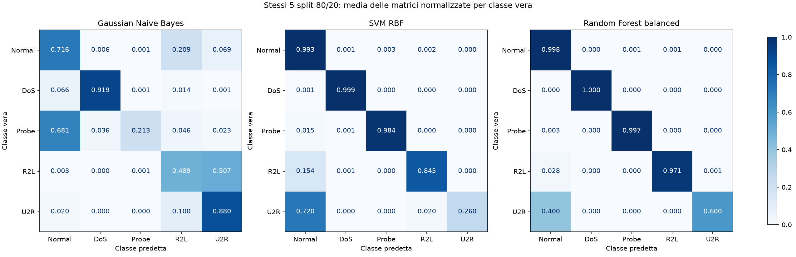

# Gaussian Naive Bayes e SVM RBF — T15–T20

Misurato il 2 novembre 2026. Un notebook per modello:
[09 Gaussian Naive Bayes](../notebooks/09_gaussian_naive_bayes.ipynb),
[10 SVM RBF](../notebooks/10_svm_rbf.ipynb).

## Protocollo e scelte dichiarate

- KDDTrain+ completo, 125973 record; tutte le 41 feature; cinque famiglie.
- Cinque split stratificati 80/20, seed 1–5, 100778 train e 25195 validation;
  stessi indici e target del riferimento congelato. Dieci fit nuovi in tutto:
  cinque NB seguiti da cinque SVM; il primo SVM è incluso, non ripetuto.
- One-hot denso delle tre categoriche, StandardScaler delle 38 numeriche, entrambi
  appresi sul solo training con Pipeline e clone per run. Nessuna feature eliminata.
- NB: priors=None, var_smoothing=1e-9. Standardizzare anche per NB evita che unità
  numeriche molto diverse dominino la stabilizzazione globale delle varianze.
  Le dummy non sono gaussiane e l'indipendenza condizionata è un'approssimazione.
- SVC: kernel=rbf,C=1,gamma=scale,class_weight=None,probability=False,tol=0.001,
  max_iter=-1,cache_size=512. Cinque fit_status_=0; gamma stimato solo dal training.
- NB e SVM non ricevono pesi aggiunti; RF/albero balanced sono configurazioni
  diverse. Il confronto non isola causalmente l'algoritmo dal preprocessing/pesi.
- API originali pandas/sklearn in ciascun notebook; fit e predict in sezioni distinte.
  Da src solo costanti. Nessun tuning, SMOTE, test ufficiale o nuovo fit dei riferimenti.
  Il 70/30 rimane una sensibilità precedente separata, non adottata qui.

## Risultati sulle cinque prove

Medie per run; DS campionaria (ddof=1), non intervallo di confidenza.

| Modello | Macro F1 media ± DS | Precision U2R | Recall U2R | FP U2R/run | Precision R2L | Recall R2L |
|---|---:|---:|---:|---:|---:|---:|
| Gaussian Naive Bayes | 0.434360 ± 0.038314 | 0,80% | 88,00% | 1089.0 | 6,06% | 48,94% |
| SVM RBF | 0.840586 ± 0.035241 | 62,33% | 26,00% | 1.6 | 88,45% | 84,52% |

## Gaussian Naive Bayes — esito misurato e ricontrollato

Cinque fit, nessuna ricerca di iperparametri. **Macro F1 medio 0.434360
± 0.038314 DS**, accuracy media 74,18%.

| Famiglia | Precision media | Recall medio | Errore medio | FP medi/run |
|---|---:|---:|---:|---:|
| U2R | 0,80% | 88,00% | 12,00% | 1089.0 |
| R2L | 6,06% | 48,94% | 51,06% | 3044.8 |

Il recall U2R elevato non basta: la precision bassissima e il numero di falsi
positivi indicano che quasi tutti gli allarmi U2R sono errati. Anche R2L e Probe
sono deboli in questa configurazione. La baseline non migliora il confronto
precedente nel complesso; non cambiamo parametri dopo aver osservato questi numeri.

Metriche ricalcolate indipendentemente dai NPZ; stessi indici/target degli altri
modelli. Le cinque prove riutilizzano 31 U2R distinti: non sono campioni indipendenti.

## SVM RBF — esito misurato e ricontrollato

Cinque fit, nessuna ricerca di iperparametri. **Macro F1 medio 0.840586
± 0.035241 DS**, accuracy media 99,32%.

| Famiglia | Precision media | Recall medio | Errore medio | FP medi/run |
|---|---:|---:|---:|---:|
| U2R | 62,33% | 26,00% | 74,00% | 1.6 |
| R2L | 88,45% | 84,52% | 15,48% | 22.0 |

Per leggere il compromesso, la RF già disponibile aveva precision/recall U2R
78,34%/60,00%; per R2L
94,83%/97,09%.
In questa configurazione SVM ha precision e recall inferiori alla RF per entrambe
le famiglie rare: perde in media il 74% degli U2R e il 15,48% degli R2L. Migliora
molto il confronto complessivo rispetto a Naive Bayes, ma non migliora il risultato
RF già disponibile. Le matrici affiancate sono nel [notebook10](../notebooks/10_svm_rbf.ipynb). Non scegliamo
automaticamente dal solo macro F1 e non affermiamo che una
configurazione iniziale esaurisca le possibilità del metodo.

Tutti e cinque i fit SVM sono convergenti (`fit_status_=0`); tempo medio fit 29.20s,
predizione 8.04s su questa macchina. Il seed1 è incluso, non ripetuto.

Metriche ricalcolate indipendentemente dai NPZ; stessi indici/target degli altri
modelli. Le cinque prove riutilizzano 31 U2R distinti: non sono campioni indipendenti.

## Come riprodurre e controllare

Per una copia senza artefatti locali: [ambiente e download nel README](../README.md),
poi [04](../notebooks/04_repeated_validation.ipynb) →
[05](../notebooks/05_rare_class_diagnosis.ipynb) →
[06](../notebooks/06_class_weight.ipynb) →
[07](../notebooks/07_random_forest.ipynb) →
[09](../notebooks/09_gaussian_naive_bayes.ipynb) →
[10](../notebooks/10_svm_rbf.ipynb). L'08 non è necessario per produrre questi artefatti.
Il04 corrente deve rimanere sui cinque seed1–5. I fit dei riferimenti in04/06/07
servono solo se i relativi risultati mancano; in questo blocco non sono stati ripetuti.

Usare il kernel Python (NSL-KDD) dell'ambiente esistente. Il confronto richiede
gli artefatti di 04–07: 05 rigenera lo snapshot del riferimento senza fit;
06/07 producono le varianti già disponibili. Se presenti, non occorre riaddestrarle.
Eseguire 09, poi10 da kernel pulito: ciascuno esegue cinque nuovi fit.
Per consultare soltanto: aprire i notebook già eseguiti o gli HTML in artifacts/.

Ogni modello salva artifacts/<model_id>/results.json, predictions.npz, metriche
per run e classe, media/DS/min/max, CM media e DS, parametri, controlli scaler/encoder,
tempi, confronto ricalcolato dai NPZ storici e differenze abbinate con l'albero15.
Schema2 senza max_depth, chiavi NPZ run_01_predicted … run_05_predicted;
Unicode e allow_pickle=False. Il notebook10 affianca le matrici dei cinque modelli.

Controlli: indici/target/hash originali, ricalcolo manuale delle metriche dai NPZ,
statistiche e vocabolario dal solo train, priors NB e gamma/convergenza SVM.
Quattordici nuovi casi delle celle reali, osservati RED poi GREEN: ordine/risposte
discordanti, classe rara mai predetta, schema sconosciuto e identità del modello.
Suite completa 41 test. Dopo la review, ricontrollate le celle di confronto con
i nuovi vincoli senza ripetere i fit; predizioni e metriche sono rimaste identiche.
Verifica dei 42 file precedenti protetti in .local/nb-svm/before_hashes.json.
Log/ledger locali in .local/nb-svm/; file di controllo temporanei fuori dal pubblicabile.

## Limiti

Le validation si sovrappongono e riutilizzano 31 U2R distinti, 10 per singolo split.
Restano i limiti di duplicazione e provenienza descritti in DATA_AUDIT.md e DATA_SOURCE.md.
Non è una replica numerica del paper, che usa un altro protocollo e preprocessing
non completamente documentato. Non cambiamo pesi o iperparametri dopo questi esiti
nel blocco corrente. Rete neurale/K-Means e il benchmark ufficiale restano passi futuri.

## Documentazione sklearn

- [GaussianNB](https://scikit-learn.org/stable/modules/generated/sklearn.naive_bayes.GaussianNB.html)
- [SVC](https://scikit-learn.org/stable/modules/generated/sklearn.svm.SVC.html)
- [StandardScaler](https://scikit-learn.org/stable/modules/generated/sklearn.preprocessing.StandardScaler.html)

Nota di compatibilità: sklearn1.9.1 segnala la deprecazione dell'argomento esplicito
probability=False di SVC. Il warning non è un errore di convergenza; l'argomento
misurato resta registrato per riproducibilità. Non sono state stimate probabilità.

## Revisione finale

Review indipendente di sola lettura: nessun errore critico/importante nei risultati.
Precisati titoli dei modelli e istruzioni correnti rispetto allo storico10run.
Rafforzata la lettura con rifiuto di schemi sconosciuti e identità del modello
discordanti: sei casi di regressione RED→GREEN e confronto reale rieseguito senza
fit, con CSV/JSON/NPZ byte-identici. Nessun comportamento del modello modificato.

## Confronto diretto con Random Forest

Stessi cinque split80/20 seed1–5, stessi record e target, tutte41feature.
Risultati ricalcolati dalle predizioni salvate, nessun nuovo addestramento.

| Modello | Accuracy media | Macro F1 media ± DS | Weighted F1 medio |
|---|---:|---:|---:|
| Gaussian Naive Bayes | 74,18% | 0.4344 ± 0.0383 | 0.7834 |
| SVM RBF | 99,32% | 0.8406 ± 0.0352 | 0.9931 |
| Random Forest balanced | 99,83% | 0.9200 ± 0.0312 | 0.9982 |

| Modello | Precision U2R | Recall U2R | Errore U2R | FP U2R/run | Precision R2L | Recall R2L | Errore R2L |
|---|---:|---:|---:|---:|---:|---:|---:|
| Gaussian Naive Bayes | 0,80% | 88,00% | 12,00% | 1089.0 | 6,06% | 48,94% | 51,06% |
| SVM RBF | 62,33% | 26,00% | 74,00% | 1.6 | 88,45% | 84,52% | 15,48% |
| Random Forest balanced | 78,34% | 60,00% | 40,00% | 2.2 | 94,83% | 97,09% | 2,91% |

| Classe vera | Naive Bayes: errore | SVM: errore | RF: errore |
|---|---:|---:|---:|
| Normal | 28,38% | 0,67% | 0,18% |
| DoS | 8,13% | 0,06% | 0,03% |
| Probe | 78,65% | 1,60% | 0,29% |
| R2L | 51,06% | 15,48% | 2,91% |
| U2R | 12,00% | 74,00% | 40,00% |

**Interpretazione:** la RF balanced è il compromesso migliore fra queste tre
configurazioni nelle prove correnti. Su R2L ha sia precision sia recall maggiori;
su U2R migliora entrambi rispetto a SVM. SVM produce 1,6 FP U2R/run contro2,2 RF,
ma riconosce soltanto il26% degli U2R contro60%: il calo degli allarmi accompagna
molti più attacchi persi. NB riconosce88%U2R, ma con precision0,80% e1089FP/run;
non è un miglioramento utilizzabile in questo confronto. RF conserva comunque
un erroreU2R40%, ancora elevato. Anche la classe Probe distingue nettamente NB.

Le righe delle matrici sono le classi vere, le colonne quelle predette; l'errore
è1−diagonale. I falsi positivi non si leggono dal solo recall: affiancare precision.
Sono configurazioni iniziali diverse: RF usa pesi balanced e numeriche non scalate;
NB/SVM nessun peso aggiunto e numeriche standardizzate. Non attribuire causalmente
ogni differenza al solo algoritmo. Le validation si sovrappongono,31U2R distinti,
nessun test ufficiale o replica numerica del paper.

