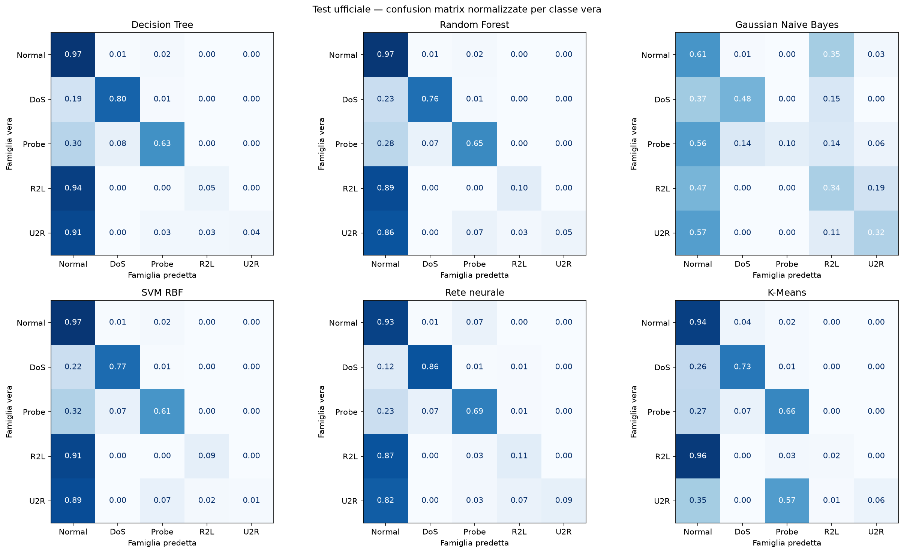

# NSL-KDD — Report del confronto sul test ufficiale

**5 novembre 2026 — confronto sul test ufficiale.**

## Risultato principale

Abbiamo completato i sei modelli usando **tutto KDDTrain+ per il training e tutto
KDDTest+ per il test**, senza split 80/20 nei nuovi esperimenti. La rete neurale ottiene
il macro F1 più alto tra queste configurazioni (**0.5469**), ma il suo
recall è **10.71% per R2L** e **8.50% per U2R**.
Il punteggio aggregato non basta quindi a descrivere il riconoscimento delle classi rare.

I risultati sul test sono nettamente inferiori a quelli della validation interna.
Il confronto con il paper è ora più pertinente, ma resta descrittivo: parametri,
preprocessing e numero di feature non coincidono con quelli degli autori.

## 1. Cosa è stato eseguito

- Training: **125.973 righe** di KDDTrain+; test: **22.544 righe** di KDDTest+.
- **41 feature** originali, che diventano 122 colonne con one-hot delle tre categoriche.
- Target e difficulty esclusi. Encoder e, dove previsto, scaler appresi solo sul training.
- Cinque famiglie, profilo autore: worm→R2L e httptunnel→U2R. Test: Normal 9.711,
  DoS 7.458, Probe 2.421, R2L 2.754, U2R 200. Lo storico conserva il mapping precedente.
- Parametri congelati in T28, prima della prima predizione ufficiale; nessuno SMOTE,
  selezione di feature, tuning o modifica guidata dal test. Un seed 1 per i modelli
  stocastici, una configurazione per modello.
- Gli esperimenti 80/20 restano come validation interna separata. Il passaggio al
  training completo non cancella il lavoro precedente.

| Modello | Configurazione | Numeriche |
|---|---|---|
| Decision Tree | Profondità 15, seed 1, senza pesi | Originali |
| Random Forest | 100 alberi, profondità 15, balanced, seed 1 | Originali |
| GaussianNB | var_smoothing=1e-9 | StandardScaler |
| SVM | RBF, C=1, gamma=scale, senza pesi | StandardScaler |
| MLP | Uno strato da 100, ReLU/Adam, massimo 300 epoche, early_stopping=False | StandardScaler |
| K-Means | 300 cluster, Lloyd, n_init=10, seed 1 | StandardScaler |

K-Means apprende senza target; i cluster ricevono una famiglia tramite voto dei
soli esempi di training. Parità: ordine fisso delle famiglie; cluster vuoto:
maggioranza globale del training. Il test non assegna etichette ai cluster.

Protocollo completo: [OFFICIAL_TEST_PROTOCOL.md](OFFICIAL_TEST_PROTOCOL.md) e
[configurazione congelata](../configs/official_test_v1.json).

## 2. Confronto tra i nostri modelli

Ordine per macro F1, la metrica primaria. Errore di classe = 1−recall, ossia quota
di esempi della classe assegnati altrove. Sono risultati singoli, non medie di run.

| Modello | Macro F1 | Weighted F1 | Accuracy | Errore R2L | Errore U2R |
|---|---|---|---|---|---|
| Rete neurale | 0.5469 | 0.7413 | 77.32% | 89.29% | 91.50% |
| Random Forest | 0.5270 | 0.7184 | 75.19% | 89.76% | 95.00% |
| Decision Tree | 0.5099 | 0.7186 | 75.96% | 94.55% | 96.50% |
| SVM RBF | 0.5063 | 0.7144 | 75.06% | 91.29% | 98.50% |
| K-Means | 0.4846 | 0.6743 | 71.89% | 98.37% | 94.00% |
| Gaussian Naive Bayes | 0.3352 | 0.4923 | 47.37% | 66.16% | 68.00% |

### Classi rare: recall e precision insieme

| Modello | Classe | Corretti/supporto | Precision | Recall | Falsi positivi |
|---|---|---|---|---|---|
| Decision Tree | R2L | 150/2754 | 95.54% | 5.45% | 7 |
| Decision Tree | U2R | 7/200 | 87.50% | 3.50% | 1 |
| Random Forest | R2L | 282/2754 | 96.91% | 10.24% | 9 |
| Random Forest | U2R | 10/200 | 41.67% | 5.00% | 14 |
| Gaussian Naive Bayes | R2L | 932/2754 | 15.89% | 33.84% | 4935 |
| Gaussian Naive Bayes | U2R | 64/200 | 6.15% | 32.00% | 977 |
| SVM RBF | R2L | 240/2754 | 97.96% | 8.71% | 5 |
| SVM RBF | U2R | 3/200 | 75.00% | 1.50% | 1 |
| Rete neurale | R2L | 295/2754 | 70.74% | 10.71% | 122 |
| Rete neurale | U2R | 17/200 | 85.00% | 8.50% | 3 |
| K-Means | R2L | 45/2754 | 78.95% | 1.63% | 12 |
| K-Means | U2R | 12/200 | 63.16% | 6.00% | 7 |

Un recall alto con precision bassa significa molti falsi allarmi. Al contrario,
precision alta con recall basso significa che le poche segnalazioni sono spesso
corrette, ma molti attacchi sfuggono. Il supporto U2R è 200: un singolo caso cambia
il recall di 0,5 punti percentuali.

Righe: famiglia vera; colonne: predetta; diagonale: recall. La scala è identica
in tutti i pannelli. Conteggi assoluti e matrici complete sono nei singoli notebook.

## 3. Confronto con il benchmark

Fonte: Divekar et al., *Benchmarking datasets for Anomaly-based Network Intrusion
Detection: KDD CUP 99 alternatives*, [Tabella IV, PDF pagina 6](https://arxiv.org/pdf/1811.05372).
Usiamo esclusivamente le righe **NSL-KDD senza SMOTE**. I valori pubblicati sono
arrotondati a percentuali intere; i delta non indicano significatività statistica.

### Weighted F1

| Modello | Paper weighted F1 | Nostro weighted F1 | Delta (punti percentuali) |
|---|---|---|---|
| Decision Tree | 68% | 71.86% | +3.86 |
| Random Forest | 70% | 71.84% | +1.84 |
| Gaussian Naive Bayes | 57% | 49.23% | -7.77 |
| SVM RBF | 74% | 71.44% | -2.56 |
| Rete neurale | 71% | 74.13% | +3.13 |
| K-Means | 68% | 67.43% | -0.57 |

### F1 per famiglia — paper → nostro, in percentuale

| Modello | Normal | DoS | Probe | R2L | U2R |
|---|---|---|---|---|---|
| Decision Tree | 77 → 78.65 | 84 → 87.54 | 66 → 71.75 | 3 → 10.31 | 12 → 6.73 |
| Random Forest | 79 → 78.06 | 87 → 84.62 | 70 → 73.35 | 0 → 18.52 | 4 → 8.93 |
| Gaussian Naive Bayes | 73 → 55.90 | 63 → 61.98 | 7 → 17.77 | 29 → 21.62 | 4 → 10.31 |
| SVM RBF | 80 → 77.88 | 84 → 85.59 | 72 → 70.72 | 31 → 16.01 | 12 → 2.94 |
| Rete neurale | 79 → 79.35 | 85 → 91.11 | 74 → 68.92 | 3 → 18.61 | 5 → 15.45 |
| K-Means | 78 → 75.62 | 84 → 80.48 | 52 → 72.06 | 3 → 3.20 | 3 → 10.96 |

Questi sono **F1**, non recall o percentuali di errore: non vanno confrontati
direttamente con la diagonale delle confusion matrix. Non disponiamo qui delle
predizioni degli autori, quindi non ricostruiamo recall, matrici o intervalli del paper.

Le differenze non dimostrano superiorità del nostro metodo: usiamo one-hot,
41 feature e configurazioni nostre. Il sorgente degli autori usa anche scelte diverse
dal testo, tra cui MiniBatchKMeans. La corrispondenza esatta tra sorgente e numeri
pubblicati non è certificabile; dettagli in [AUTHOR_CODE_AUDIT.md](AUTHOR_CODE_AUDIT.md).

## 4. Perché la validation precedente era più alta

| Modello | Macro F1 validation (media di 5) | Macro F1 test ufficiale (1 prova) |
|---|---|---|
| Decision Tree | 0.8754 | 0.5099 |
| Random Forest | 0.9200 | 0.5270 |
| Gaussian Naive Bayes | 0.4344 | 0.3352 |
| SVM RBF | 0.8406 | 0.5063 |
| Rete neurale | 0.8921 | 0.5469 |
| K-Means | 0.7593 | 0.4846 |

Prima dividevamo KDDTrain+ in 80% training e 20% validation, su cinque split.
Ora il training è completo, ma valutiamo un altro insieme, KDDTest+, con diversa
distribuzione e attacchi specifici non presenti nel training. Cambia anche il
mapping di 135 righe presenti soltanto nel test ufficiale.

Questo confronto **non isola l'effetto di aumentare il training dall'80% al 100%**.
Non dimostra che più training peggiori il modello, né che i vecchi dati fossero
sbagliati. Misura prestazioni in due condizioni differenti.

## 5. Diagnostica e verifiche

| Modello | Tempo fit | Diagnostica |
|---|---|---|
| Decision Tree | 4.19s | Profondità 15, 249 foglie |
| Random Forest | 15.22s | 100 alberi |
| Gaussian Naive Bayes | 0.47s | Nessun avviso |
| SVM RBF | 83.78s | fit_status=0; convergente |
| Rete neurale | 120.83s | 74 epoche; limite non raggiunto |
| K-Means | 407.38s | 44 iterazioni; 10 restart interni |

Tempi del solo fit nella stessa macchina, indicativi e senza ripetizioni dedicate.
SVM segnala soltanto la futura rimozione del parametro probability nella versione
sklearn usata; fit_status=0. Non è un avviso di mancata convergenza. Gli avvisi di
tutti i modelli e la loss della rete sono conservati negli artefatti.

Cinque nuovi fit, uno per T32–T36; K-Means comprende 10 restart interni. Il confronto
T37 esegue zero fit. T31 aveva richiesto due esecuzioni tecniche identiche per
correggere il salvataggio JSON: una configurazione, non due prove indipendenti.
Tutti i nuovi notebook sono eseguiti da kernel pulito. Le metriche sono ricalcolate
dalle predizioni; verificati input/protocollo, indici/target, conteggi, parametri,
statistiche del preprocessing e, per K-Means, voto e assegnazione ai centroidi.

## 6. Limiti e lettura del risultato

- Configurazioni singole: il migliore di questo confronto non è necessariamente
  il migliore ottenibile per quel tipo di modello. Nessuna stima della variabilità.
- Classi sbilanciate: weighted F1 e accuracy possono nascondere gli errori rari.
- Duplicati e 654 vettori di feature distinti condivisi tra training e test sono
  conservati; il test non è interamente nuovo.
- Conteggi dei file diversi da quelli nel paper (125.972/22.542): non abbiamo eliminato
  righe per forzare una corrispondenza.
- Il test ufficiale è stato consultato. Nuove modifiche motivate da questi risultati
  dovranno essere dichiarate esplorative; per scegliere parametri occorre tornare
  alla validation interna al training.

## 7. Analisi successive

Il benchmark è stato seguito dalla [diagnosi per tipo di attacco](ATTACK_DIAGNOSIS.md), dall’[analisi dei falsi allarmi](FALSE_ALARMS_AND_CONCLUSIONS.md) e dal [confronto binario conclusivo con DLHA](DLHA_OFFICIAL_COMPARISON.md).

Notebook di confronto: [21_official_benchmark_comparison.ipynb](../notebooks/21_official_benchmark_comparison.ipynb).
Notebook dei modelli: [Decision Tree](../notebooks/15_decision_tree_official_test.ipynb),
[Random Forest](../notebooks/16_random_forest_official_test.ipynb),
[GaussianNB](../notebooks/17_gaussian_nb_official_test.ipynb),
[SVM](../notebooks/18_svm_official_test.ipynb),
[MLP](../notebooks/19_neural_network_official_test.ipynb),
[K-Means](../notebooks/20_kmeans_official_test.ipynb).
CSV/NPZ e riepiloghi JSON locali: artifacts/*_official_test e
artifacts/official_benchmark_comparison. Parametri, hash, versioni e indici consentono
di ricostruire il confronto senza ripetere gli addestramenti.

## Verifica conclusiva

Suite completa: **91 test superati**. I 15 nuovi casi coprono
configurazioni, preprocessing, voto K-Means e rifiuto di artefatti incoerenti.
Controlli inizialmente falliti e poi superati. Sei nuovi notebook eseguiti da kernel
puliti, cinque nuovi fit, nessun refit storico. 237 file preesistenti invariati.
Review indipendente: nessun rilievo critico, importante o minore. Revisione statica indipendente di codice, report, fonti e audit; test e verifiche numeriche eseguiti dall'agente principale.

Scelta operativa: mantenuto il branch esistente senza commit base, usando file
nuovi e manifesto hash anziché un nuovo worktree. Il minore isolamento è compensato
dalla verifica dello storico. Nessun commit, push o pubblicazione effettuato.
